# Windows系统后门-隐藏账户

创建：2022年11月03日

Review: 2026-10-30 21:32:43

# 1. 技术介绍

## 1.1 简介

创建本地账户（T1136.001 - ATT&CK）归属于权限维持（Persistence，TA0003）下的创建账户（T1136）。

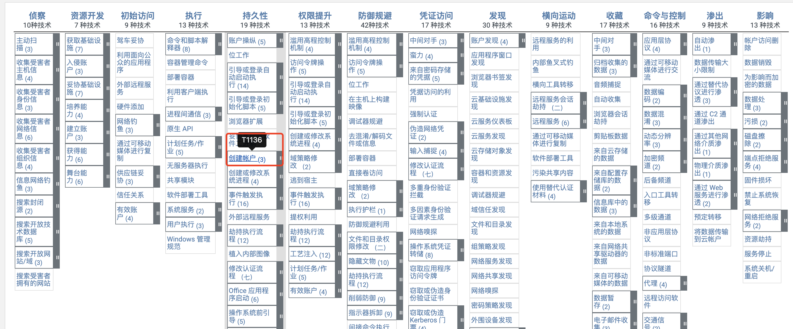

攻击者可以创建一个本地帐户来维持对受害系统的访问。net user /add命令可用于创建本地帐户。在macOS系统上，该dscl -create命令可用于创建本地帐户。

## 1.2 使用范围

Windows系统。

## 1.3 攻击限制

需获取主机执行权限或者主机Administrator账户凭证。

# 2 攻击视角

## 2.1 攻击场景

1.攻击前序：攻击者拥有了目标主机的执行权限，或者获取了Administrator账户凭证

2.攻击后续：攻击者可以窃取系统凭证信息

- Credential Access —— T1003 OS Credential Dumping

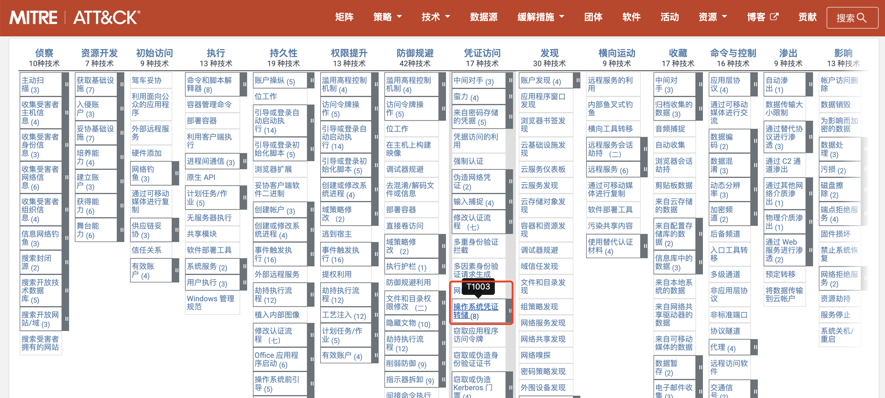

## 2.2 攻击复现

复现环境信息

|主机类型|windows主机|
| ------------| -------------------------|
|操作系统版本|Windows 10 Server 2012 r2|
|IP地址|192.168.1.1|
|账号名称|Administrator|
|账号权限|Administrator|

攻击步骤

```plain
net user yincang$ Test1234! /add #添加yincang$隐藏用户
net localgroup administrators yincang$ /add #将yincang$用户添加进管理员组中
```

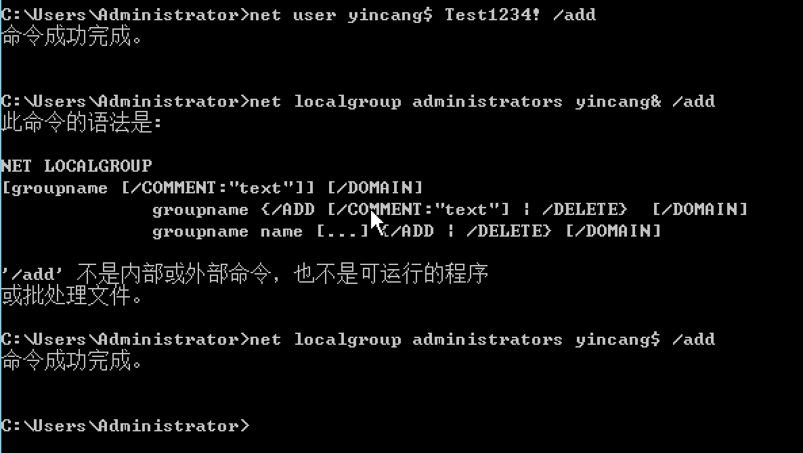

注意一：  
此时虽然使用命令行无法看到 yincang 隐藏用户，但是采用其它方法仍旧可以发现yincang隐藏用户，为了更好的隐藏新建的账户，还需要进行修改注册表文件操作。

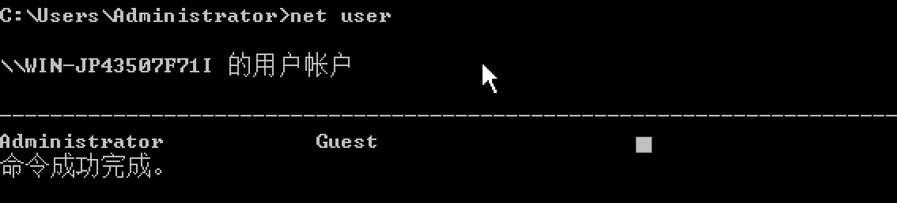

注意二：

1、打开windws server 2012的远程桌面功能

2、需将新创建的隐藏账户 yincang 添加在允许远程桌面用户的位置，默认只允许 Administrator，不然隐藏账户yincang无法登录。  

3、远程登录隐藏账户 yincang账户名是yincang密码是Test1234!

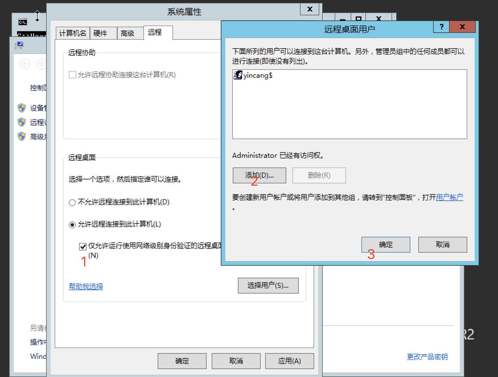

‍

查看yincang$ 隐藏用户方法一：

通过 控制面板 用户账户 管理账户 依然还是可以看到 yincang$ 账户存在的。

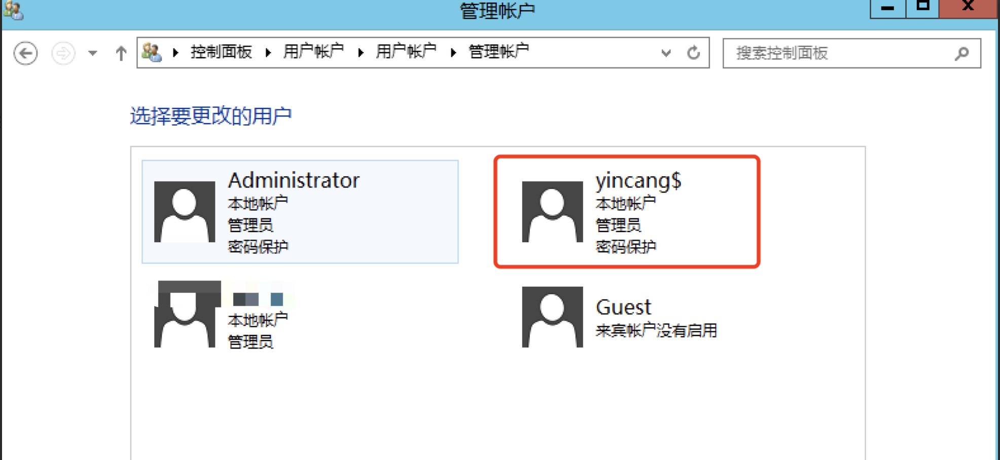

查看yincang$ 隐藏用户方法二：

或行输入命令：compmgmt.msc，即可打开计算机管理查看用户。

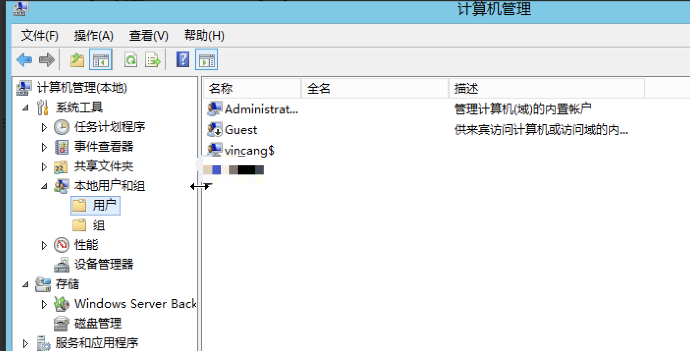

cmd输入命令即可打开注册表:  **regedt32 **

首先打开注册表编辑器，找到HKEY_LOCAL_MACHINE\SAM\SAM，点击右键，选择“权限”，将Administrator用户的权限，设置成“完全控制”，然后重新打开注册表，确保可以看到SAM路径下的文件。

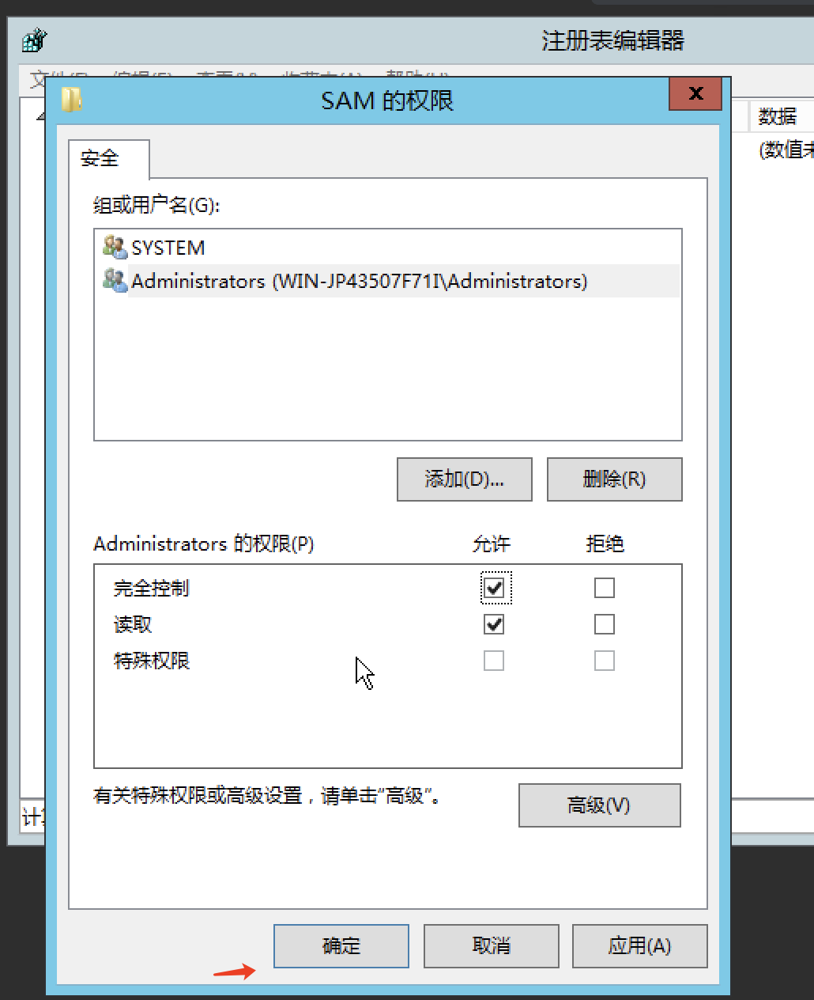

重新打开注册表，确保可以看到SAM路径下的文件

其次前往SAM/Domains/Account/Users/Names处，选择Administrator用户，在右侧的键值处可以找到对应的值如1f4，然后从左侧的Users目录下可以找到对应的文件。

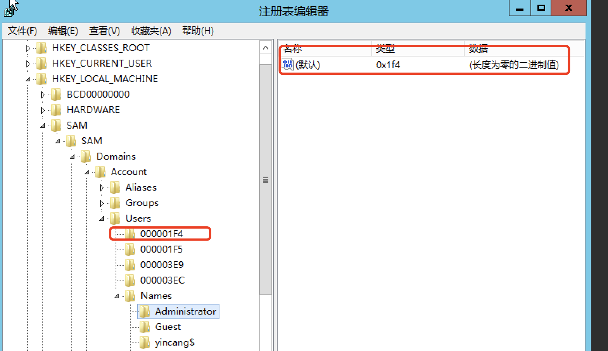

然后从对应的000001F4文件中将键值对F的值复制出来。然后同理找到隐藏账户yincang$所对应的文件000003EC，并将从Administrator文件中复制出来的F值粘贴进 yincang$所对应的000003EC的F值中。

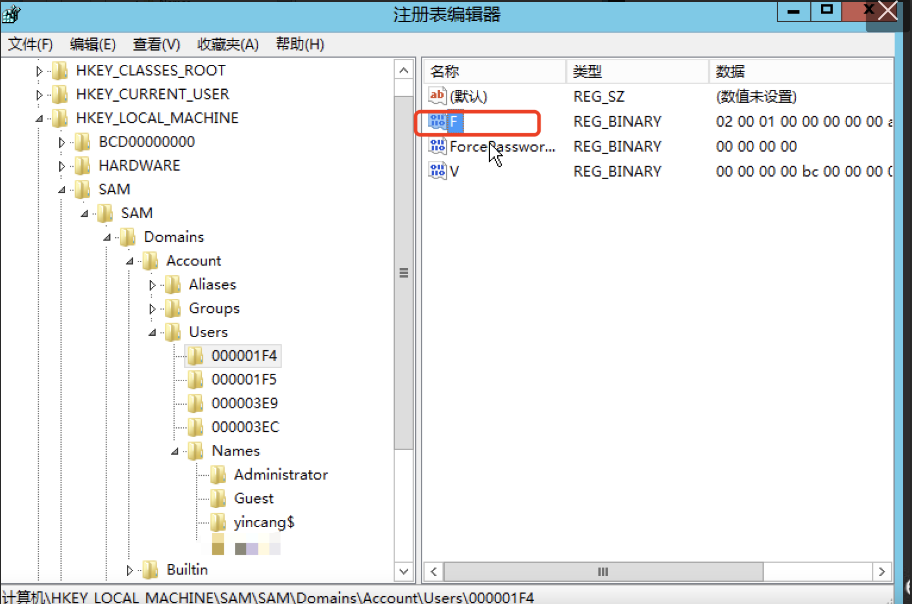

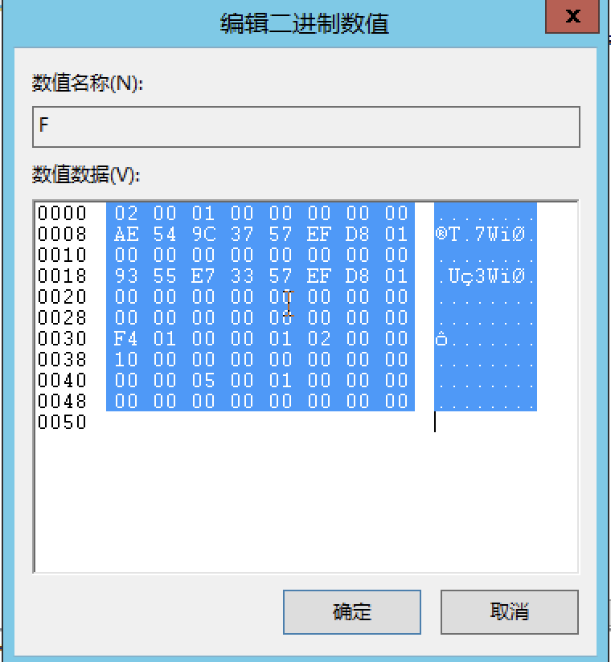

最后将yincang $和000003EC从注册表中右键导出，并删除yincang$用户，然后将刚刚导出的两个文件重新导入进注册表中即可实现yincang用户的隐藏。

删除用户命令

```plain
net user yincang$ /del
```

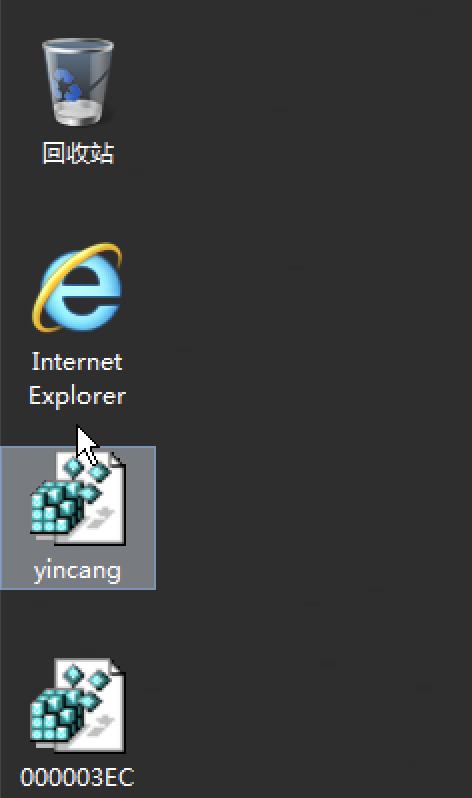

点击刚刚导出保存的 yincang和000003EC，点击之后会自动导入注册表，下图是导入成功的

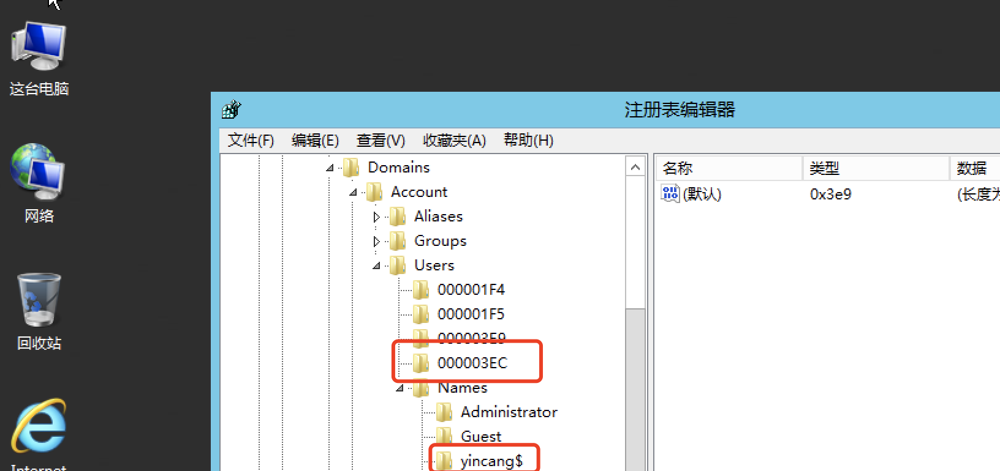

此时 yincang$隐藏账户在控制面板，用户账户，管理账户，管理工具，计算机管理 ，本地用户和组用户均未发现，成功隐藏

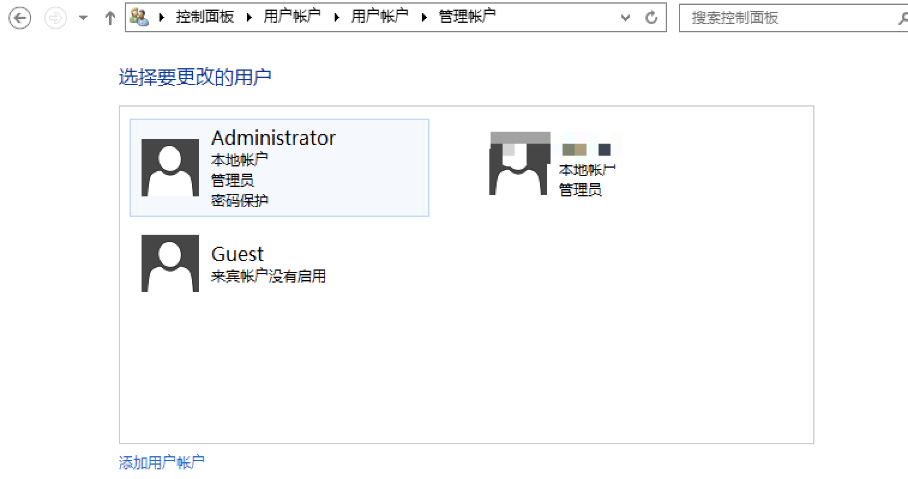

隐藏成功之后把SAM的权限取消。

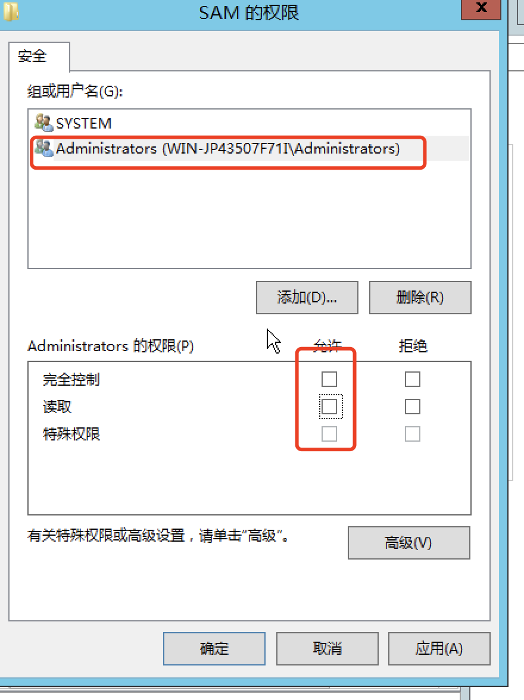

# 3 应急响应发现

输入命令：regedt32 打开注册表

首先打开注册表编辑器，找到HKEY_LOCAL_MACHINE\SAM\SAM，点击右键，选择“权限”，将Administrator用户的权限，设置成“完全控制”，然后重新打开注册表，确保可以看到SAM路径下的文件。

查看注册表，在注册表中 HKEY_LOCAL_MACHINE\SA\SAM\Domains\Account\Users\Names 位置可以看到所有的用户名，将这些用户名与控制面板，用户账户，管理账户，管理工具，计算机管理，本地用户和组用户进行对比，不存在的账户就是隐藏账户。

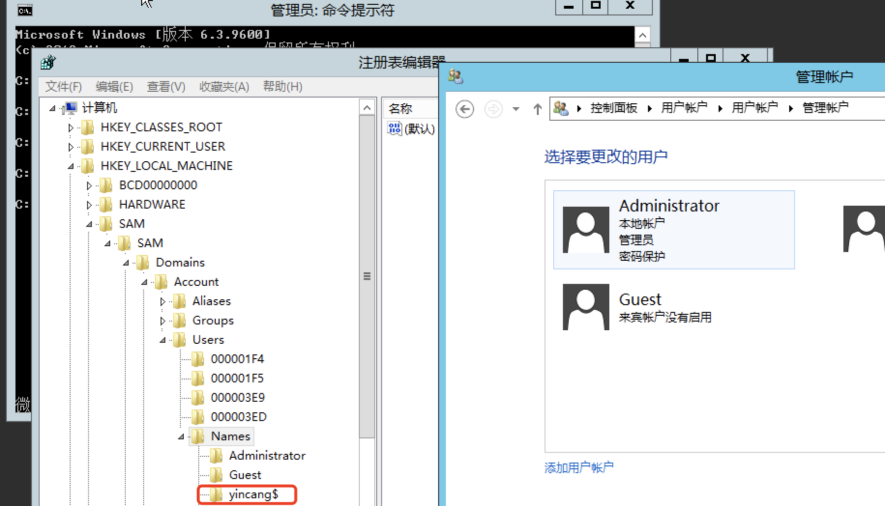

‍
