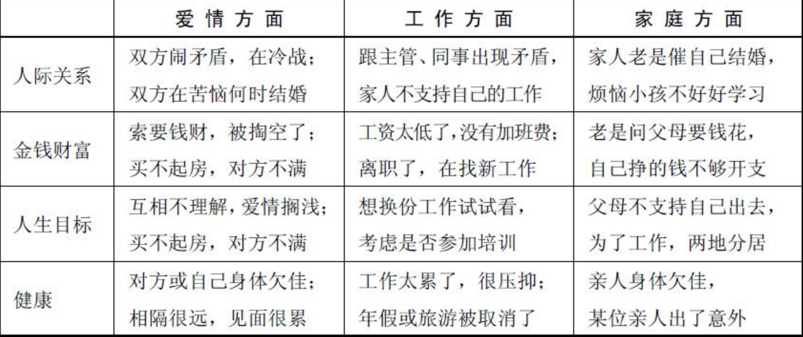
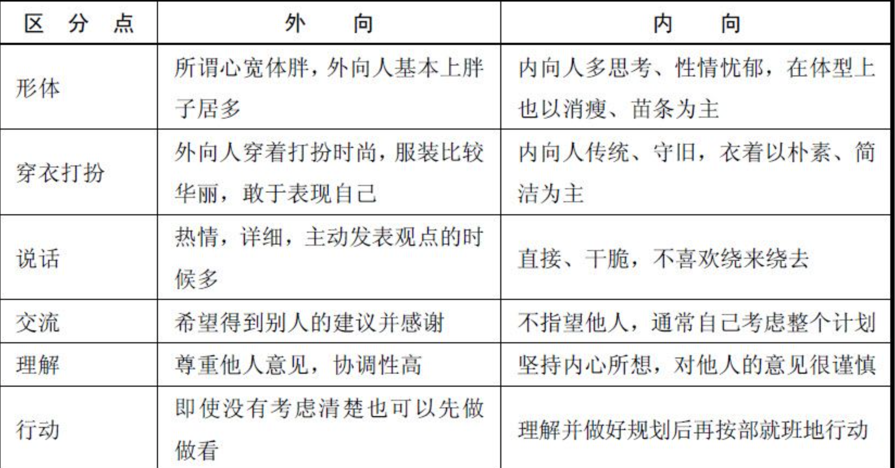
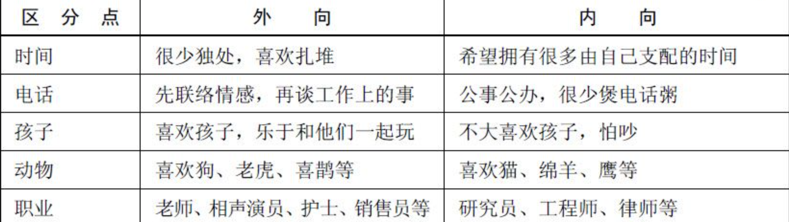

# 《冷读术》 - 石井裕之

# 摘录：

- 「双重束缚」（Doublc finds)的会话策略，是不让对方有机会说”No”的技巧。因此，封锁最初”No”的反应非常重要。 怎样才能封锁”No”呢？很简单，就是使用无法回答”No”的说法就行了，比如” 双重束缚”的会话术。 “我们去吃饭还是去喝茶？” “可是我没空。” “那么就去喝茶吧。” “嗯，喝杯茶倒还可以。  
  双重束缚技巧的重点，简而言之，就是”不要恳求对方”，因为只要有恳求的含义，就可能立刻引起”No”的反应。心理学界著名的斯德哥尔摩症候群。它揭示出人们内心中的一种可怕的弱点——对肉体及精神进行摧残后，再适度地抚慰，人是可以被驯养的。

- 一个人站得笔直，说明这个人比较有自信

- “你曾经有过一段让你无比怀念的情感吧？”这句话放在生活中的每个人身上，应该都是对的。一段情感，可以是一段恋情、一份友情，也可能是一段单相思。总之，在每个人的成长过程中，或多或少都会经历这样的事情。

- 面对老年人，请这样说。  
  老年人的关注点多为子孙、休闲、社区活动、钓鱼这些事情，我们与之交流时，可以从这些方面找些话题。“您儿子还算小有成就，小时候很调皮吧？”“您现在过的很舒适，以前也吃过不少苦吧？”

- 面对中年男性，请这样说。

- 中年的男人，事业上正处在红火的时期，但家庭方面担负着重大的责任，因此他们会较多地关注儿女、家庭、事业、热点新闻等话题。  
  “您很热衷于自己的事业，有时候也为儿女感到担忧。”  
  “虽说您现在事业有成，但遇到的挫折也不少吧？”

- 面对中年女性，请这样说。  
  对大多数的中年女性来说，她们经常关注儿女、家庭、服饰、电视剧、化妆、社交等，在交谈时，选择这些见面话题往往能激发她们的谈论热情。  
  “你家儿子真有出息，小时候没少惹事吧？”  
  “你这件衣服真漂亮，衣柜里比这好看的还有好多吧？”

- 面对青年男性，请这样说。  
  青年时期的男性朝气蓬勃，颇具活力，对娱乐尤为热衷。他们喜欢关注交友、运动、电影、旅游等相关信息。  
  “你很在乎你的朋友，但有时也会遭到误解，是这样吗？”  
  “你很积极进取，有时候又觉得自己不够努力？”

- 面对青年女性，请这样说。  
  青年女性除了善于发现生活中的美和追求休闲的生活方式之外，具有较强的上进心、进取心，因此她们较多地关注逛街、购物、美容、装扮、充电等话题。从这类话题入手，总能引起她们极大的兴趣。  
  “你很想去逛街，但心里又觉得应该给自己充一下电，是吗？”  
  “你长得这么漂亮，还是会不自觉地每天出门化妆？”
- 面对少男，请这样说。  
  对于青春年少的男孩子而言，追求时尚、爱好冒险是他们的天性。他们关注的话题多为女明星、电影、演唱会、闯荡、造型等。从这类话题引入谈话，会减少他们的叛逆、敌视。  
  “你的造型很酷，只是经常遭到家里人反对，没错吧？”  
  “总想出去闯一闯，又对陌生的外部世界感到害怕，对不对？”

- 面对少女，请这样说。  
  青春少女天生爱美，喜欢崇拜偶像，观看娱乐节目。她们的关注点多为服饰、打扮、男明星、电影、电视剧等。从这类话题引入谈话，会激发她们参与交谈的积极性。  
  “每次看到新衣服都想买，但又怕花销太大，这种感觉很奇怪吧？”  
  “尽管平时爸妈管教很严，但还是经常偷偷在家看韩剧吧？”

- 在本书一开始说的巴南效应就是例行话题的魅力所在。

<!-- 这是一张图片，ocr 内容为：工作方面 爱情方面 家庭方面 跟主管,同事出现矛盾, 家人老是催自己结婚, 双方闹矛盾,在冷战; 人际关系 家人不支持自己的工作 烦恼小孩不好好学习 双方在苦恼何时结婚 工资太低了,没有加班费; 老是问父母要钱花, 索要钱财,被掏空了; 金钱财富 离职了,在找新工作 自己挣的钱不够开支 买不起房,对方不满 想换份工作试试看, 互相不理解,爱情搁浅; 父母不支持自己出去, 人生目标 为了工作,两地分居 考虑是否参加培训 买不起房,对方不满 亲人身体欠佳, 工作太累了,很压抑; 对方或自己身体欠佳; 健康 相隔很远,见面很累 年假或旅游被取消了 某位亲人出了意外 -->

- 冷读时，我们可以圈定“人际关系”、“金钱财富”、“人生目标”、“健康”这几类话题切入。当谈话开始的时候，我们可以先预测一下对方的烦恼类别，随着谈话的进行，再逐步确定。  
  “你是不是在人际关系上出了点问题啊？”（预设框架）  
  “不是的，我只是在考虑要不要回家发展。”（超出预设框架）  
  “这个问题，应该和你的家人有比较大的关系吧？”（拉回预设框架）  
  “有这方面的原因，我在想要不要回家呆在父母身边。”（被说中）  
  “现在的工作不是你继续想做的吧？”  
  不自信常常表现为避开对方的眼神，顾左右而言其他。冷读术教我们，要表现出自己的自信，必须从“注视对方的眼睛”开始，如图所示。然而，当你紧紧地盯着对方的眼睛时，你又会发现，本来轻松的心情反而弄得很紧张，变得更不自信了；还有一种情况就是盯着对方的眼睛说话，如果对方是容易害羞的异性，在你紧盯着她的眼睛跟她说话时，她会目光闪躲甚至语无伦次。|
- 使用“同调”语言。  
  人们都喜欢给予自己赏识的人。人与人交流时，“不”字一出口，就等于把大门关上了，双方就会产生一种心理紧张关系。  
  搭讪成功与否，很大程度上取决于你是否表现出了这样的高水准气场，与其畏首畏尾，不如光明磊落。当对方面对高水准的搭讪气场时，是很难拒绝的。如果你一开始表现得就不大方，不用你开口说话，人家已经离你很远了
- 实上，心理学通过研究发现，只有男人才会更注重对方的容貌，而大多数女人其实更看重男人的自信、微笑、仪表、幽默感、亲和力以及能否成为人群中的焦点等因素——这也是尼尔·施特劳斯在《把妹达人》中阐述的领袖男人的特质。

- 库存通用句  
  “你曾经因为个性吃过亏吧！即使是初次相见的人，也能看出你的个性，不过也是因为这个原因，使得对方认为你过于原则，无法成为你最知心的朋友吧？”
- 人在交朋友时总是喜欢找与自己个性相配的人，其实交往时间长了会发现和自己合得来的是和自己个性相反的人。”

<!-- 这是一张图片，ocr 内容为：内 外向 区分点 内向人多思考,性情忧郁,在体型上 所谓心宽体胖,外向人基本上胖 形体 也以消瘦,苗条为主 子居多 外向人穿着打扮时尚,服装比较 内向人传统,守旧,衣着以朴素,简 穿衣打扮 华丽,敢于表现自己 洁为主 热情,详细,主动发表观点的时 直接,干脆,不喜欢绕来绕去 说话 候多 交流 不指望他人,通常自己考虑整个计划 希望得到别人的建议并感谢 坚持内心所想,对他人的意见很谨慎 尊重他人意见,协调性高 理解 即使没有考虑清楚也可以先做 理解并做好规划后再按部就班地行动 行动 做看 -->

<!-- 这是一张图片，ocr 内容为：区分点 外向 内向 很少独处,喜欢扎堆 希望拥有很多由自己支配的时间 时间 先联络情感,再谈工作上的事 公事公办,很少煲电话粥 电话 喜欢孩子,乐于和他们一起玩 孩子 不大喜欢孩子,怕吵 喜欢狗,老虎,喜鹊等 喜欢猫,绵羊,鹰等 动物 研究员,工程师,律师等 老师,相声演员,护士,销售员等 职业 -->

- 与内向型人沟通的方法  
  这是我专门为你挑选的礼物，别人都没有的”，还有“这工作由你来做是最合适的，因为只有你才会”等，满足他的自尊心，激发他的工作动力。  
  心理学研究表明，如果通过问句的方式来询问一个人，并且让这个人不断地处在相同的回答之中，那么这个人就很容易受人控制。这就是著名的“睡眠效应”，冷读术中的连续肯定句模式也是利用这一原理开发的。

- 先否定再肯定的技巧  
  人际关系心理学中有一个人际交往的“增减原则”，这种现象是因为每个人在人际交往中把自我价值放到第一位，最关注的还是甲：“这个咖啡好苦，很不好喝。”也．自己。如果你真的对一个人或一件事有意见，有话要说，那就试试先否定再肯定的技巧。  
  以这样的方式表达你的邀请，对方很容易构筑“不”的回答模式，无论怎样都可以拒绝你。如果你想邀请成功，就可以用“双重束缚”说服术。

- 活用“扩大法”的技法  
  扩大局部  
  如果我们没有说中对方的某一局部信息，就可以把这个局部扩大到一定的整体。  
  甲：“你看起来眼睛有些疲劳啊。”  
  乙：“没有啊，我很精神啊。”  
  甲：“真的吗？你不觉得身体有一些不舒服吗？”  
  乙：“嗯，身体最近快吃不消了，老是加班。”

- 边界模糊化  
  在约会中我们也可以使用扩大法，我们和对方商量具体的约会时间、地点等，如果对方没有同意，我们就可以把这个受限制的边界模糊化，让对方无托词可用。

- 未做的转为具体  
  把明天具体为今夜零时之后，具体化了时间，还使自己摆脱忘记的嫌疑，对方自然就信任了自己，这样不是很厉害吗？

- 把抱怨切割开的分割法  
  “关于我的迟到我真心向你道歉，我的迟到给你造成了困扰，让你着急是我不对。我问你啊，因为我迟到让你感觉我没有上进心了吗？你能否告诉我，我最不上进的是哪一方面？”  
  就是这样，你的迟到本身已经错了，所以先接受对方所说的一切，给予真诚的道歉。无论面对哪种抱怨，都要先道歉，接下来就是让对方说明“在这抱怨的内容中”哪个是之最，这个例子中就是“最不上进”。

- 如果你想追一位女子，她可能已经有男朋友了，一般情况下，许多人都放弃了，但你如果用这种话术还是可以试探一下的。  
  “当然啦，你作为XX的女朋友，就得对他保持忠诚，不过，你作为一名新时代女性，我不希望你就这样成为一只金丝鸟。”  
  就这样，通过把女性的身份分割成了“XX的女朋友”和“一名新时代女性”，一些不方便讲出的话也就讲出口了。  
  同样，这样的话术也常常被一些女孩用来攻陷自己心仪的已经有女朋友的上司、偶像的惯用手段。

# 感想：

- 约人给选择题，而不是填空题。

- 先摧残再抚慰

- 健身能让我站直，能提升自信。

- 针对不同年龄你段类型的人找不同的话题聊天。

- 对老人就说他们的儿女、对中年男性就说事业或者家庭、中年女性就说衣服和电视剧、对青年男性就说电影、青年女性就讲化妆

- 可以根据一个大方向再讲小方向。

- 自信的表现之一就是盯着人家的眼睛说话。

- 让身边的人尝试一些没做过的事情，没穿过的衣服，尝试着做一些大胆的变化。

- 跟别人说话不要立马反驳，可以表示尊重和理解再说自己的观点。

- 自信说话，与其畏手畏脚，不如大大方方。

- 女人更看重你是否自信、幽默、微笑、亲和力

- 认同对方、问开放性问题、让对方侃侃而谈、巧妙挖掘共同点。

- 这是我专门为你准备的

- 让人多回答是的是的

- 先否定再肯定。

- 还是那句话，给选择题而不是填空题。

- 从小方向说到大方向，扩大法谈话
- 一般约第一次都约不成功，那就把时间约到下个具体日期。
- 把未做的事情如果自己忘记了就说已经决定好某个时间前的时间点，那样就摆脱了自己忘记的嫌疑。
- 忘记邀约之后用扩大法或者缩小法回答。
- 以后遇到问题，先真诚的表示抱歉，你觉得我哪里的做不好的先让对方说出来，再表示抱歉
