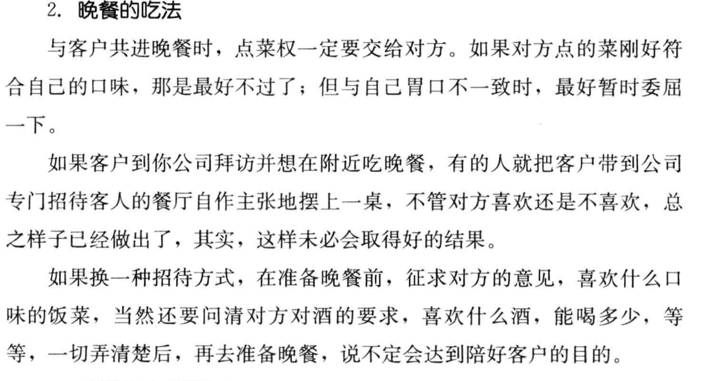
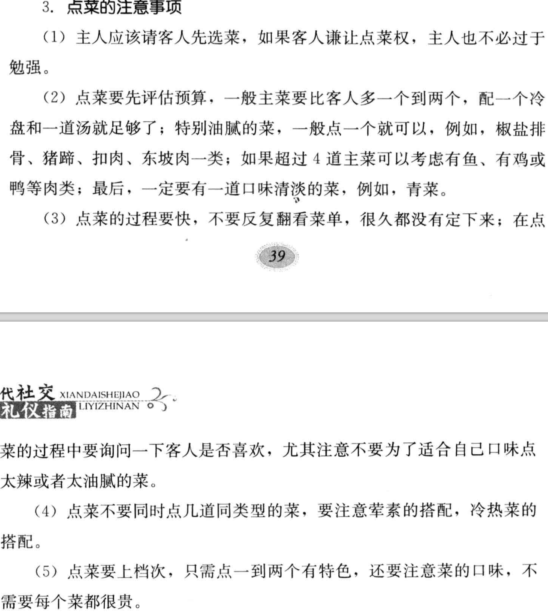
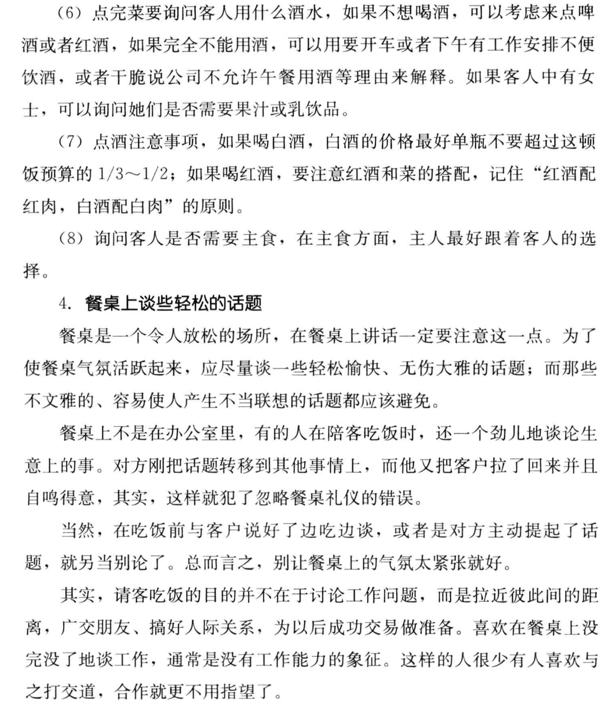
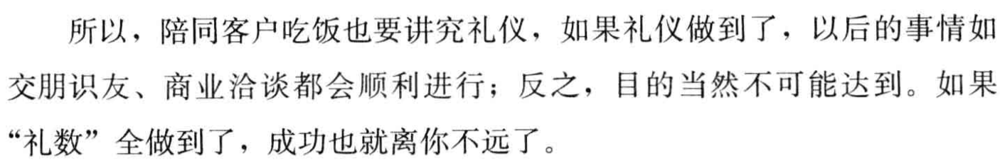
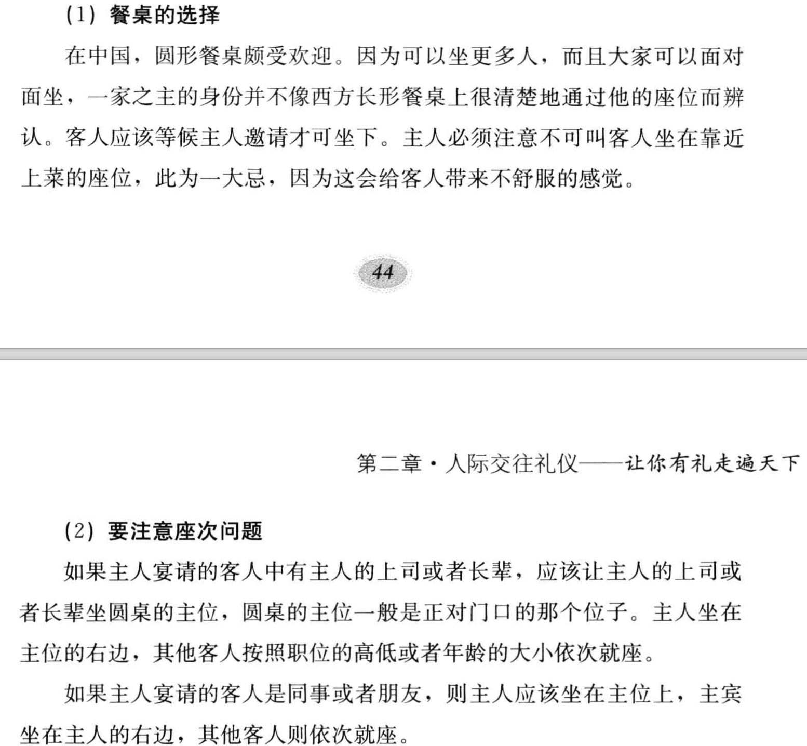
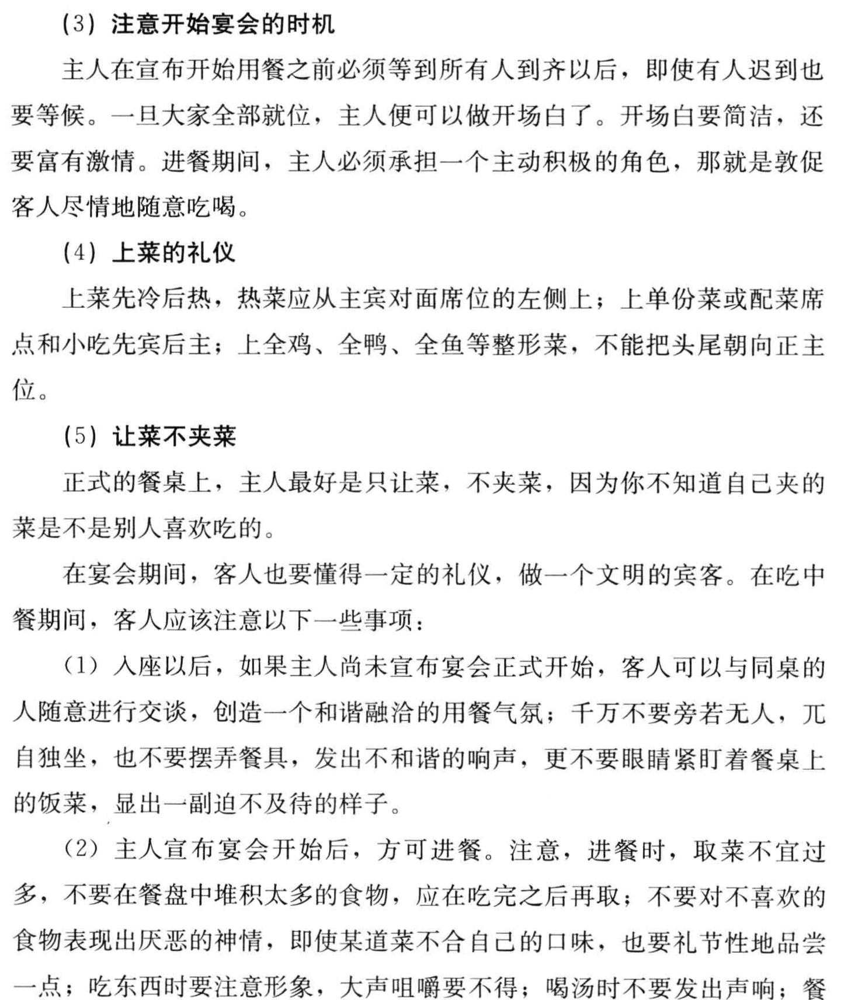
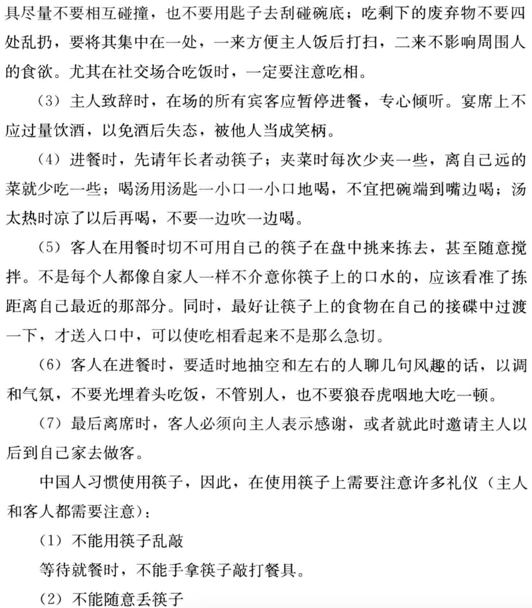
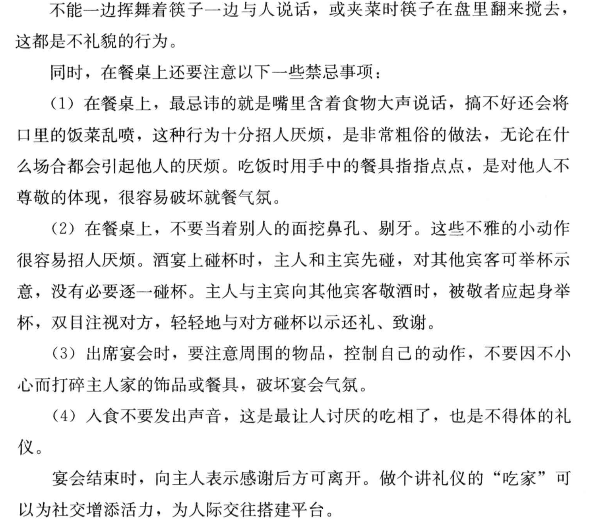
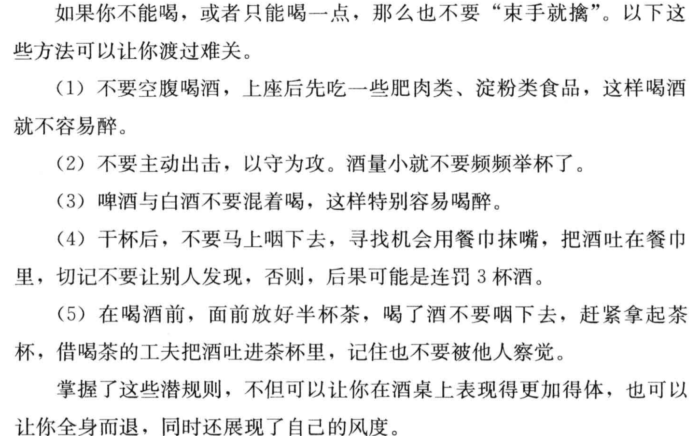

# 《现代社交礼仪指南 (马银文编著)》

更新：2026-08-26 16:44:42

# 摘录：

<!-- 这是一张图片，ocr 内容为： -->

<!-- 这是一张图片，ocr 内容为： -->

<!-- 这是一张图片，ocr 内容为： -->

<!-- 这是一张图片，ocr 内容为： -->

下面是餐桌文化

<!-- 这是一张图片，ocr 内容为： -->

<!-- 这是一张图片，ocr 内容为： -->

<!-- 这是一张图片，ocr 内容为： -->

<!-- 这是一张图片，ocr 内容为： -->

<!-- 这是一张图片，ocr 内容为： -->

# 感想：

1. 主菜比客人多一个到两个，配一个冷菜和一道汤，一定点一个青菜。点菜过程要快，在点菜过程中询问客人是否喜欢。点菜不要点几道同类型的菜，要注意荤素的搭配，冷热菜的搭配。

2. 选择圆桌，圆桌能坐更多人，而且可以面对面坐。

3. 如果主人宴请的客人有主人的上司或者长辈，应该让主人的上司或者长辈坐圆桌的主位，圆桌的主位是正对们的位子。主人坐在主位的右边，其他客人按照职位的高低或者年龄的大小依次就坐。

4. 上菜先冷后热，热菜从主席对面席位的左侧上；上全鸭、全鸡、全鱼等整形菜，不能把头尾朝向正主位置。

5. 让菜不夹菜。

6. 该书值的一看，各种礼仪。

7. 干杯后，不要马上咽下，寻找机会用餐巾擦嘴，把酒吐在餐巾里。
8. 以后摘录禁止截图。
