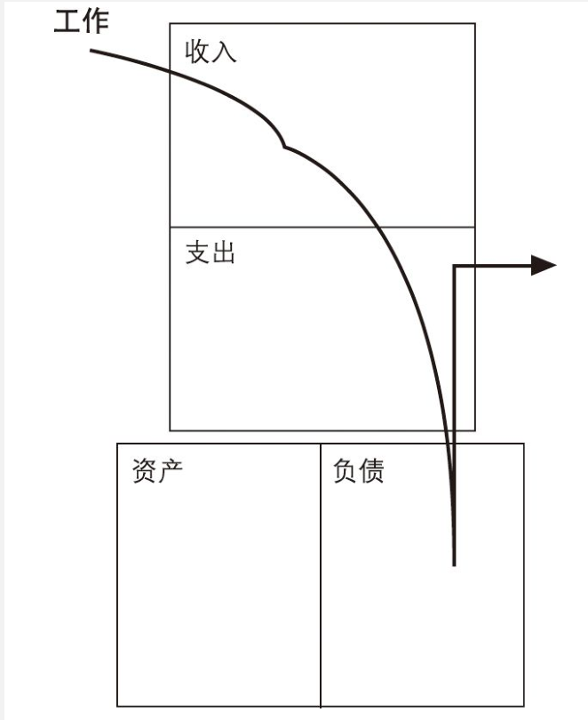
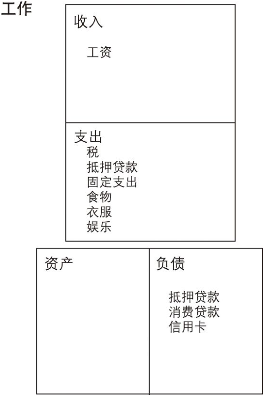
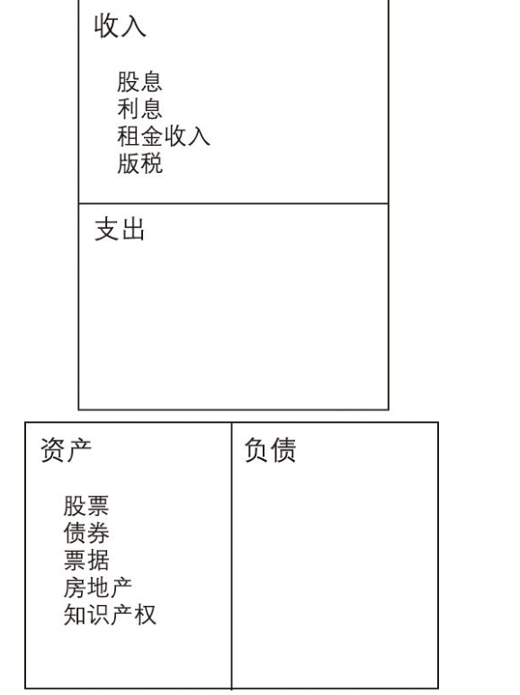

# 《穷爸爸富爸爸》

# 摘录：

- “起床，上班，付账，再起床，再上班，再付账……他们的生活从此被这两种感觉所控制：恐惧和贪婪。给他们更多的钱，他们就会以更高的开支重复这种循环。这就是我所说的‘老鼠赛跑’。”
- “富人获得资产，而穷人和中产阶级获得负债，只不过他们以为那些负债就是资产。”
- 资产是能把钱放进你口袋里的东西。负债是把钱从你口袋里取走的东西。
- 如果你想致富，只需不断买入资产就行了；
- 如果你只想当穷人或是中产阶级，只要不断地买入负债。正是因为不知道资产与负债的区别，世界上才会有这么多人有财务问题。
- 下图是负债的人负债情况

<!-- 这是一张图片，ocr 内容为： -->

<!-- 这是一张图片，ocr 内容为： -->

下图是富人情况

<!-- 这是一张图片，ocr 内容为： -->

- 最大的损失是致富机会的损失。如果你所有的钱都投在了房子上，你就不得不努力工作，因为你的现金正不断地从支出项流出，而不是流入资产项，这是典型的中产阶级现金流模式。正确的做法应该是怎样的呢？如果一对年轻夫妇能够早点在他们的资产项中多些投入，他们以后的日子就会过得轻松些，尤其是他们准备要把孩子送入大学。他们的资产会不断增长，自动弥补支出。通常情况下，买房子只不过是为了取得抵押贷款以支付不断攀升的开支。
- 中产阶级发现自己总是在财务问题上挣扎。他们最主要的收入就是工资，而当工资增加的时候，税收也就增加了，更重要的是他们的支出也和收入同步增加，接着是新一轮的“老鼠赛跑”。他们把房子作为最主要的资产，而没有把钱投在那些能带来收入的资产上
- 富人买入资产。穷人只有支出。
- 中产阶级购买自以为是资产的负债。
- 开始关注你自己的事业，在继续工作的同时购买一些房地产，而不要买负债或是一旦被你带回家就没有价值的个人用品。在你把一辆新车开出停车场的同时，它已经贬值25％了。汽车不是真正的资产，即使你的银行经理让你把它列入资产项。一根新的价值400美元的钛合金高尔夫球杆被我开过球后，就只值150美元了。
- 依我看，真正的资产可以分为以下几类：  
  1．不需我到场就可以正常运作的业务。我拥有它们，但由别人经营和管理。如果我必须在那儿工作，那它就不是我的事业而是我的职业了；  
  2．股票；  
  3．债券；  
  4．共同基金；  
  5．能够产生收入的房地产；  
  6．票据（借据）；  
  7．版税，如音乐、手稿、专利；  
  8．其他任何有价值、可产生收入或有增值潜力并且有很好销路的东西。
- 我上班，但同时也关注自己的事业。我通过买卖小公司的股票和房地产，努力增加我的资产项。富爸爸总是强调财务知识。我对会计和现金管理懂得越多，我就越能更好地进行投资分析并开始建立自己的公司。
- 当你的现金流增加时，你可以买点儿奢侈品。富人与穷人一个重要的区别就是：富人最后才买奢侈品，而穷人和中产阶级会先买下诸如大房子、珠宝、皮衣、宝石、游艇等奢侈品，因为他们想让自己看上去很富有。他们看上去的确很富有，但实际上他们已深陷贷款的陷阱之中。那些能给子孙留下遗产的人和那些能长期富有的人，就是先构筑资产项，然后才用资产所产生的收入购买奢侈品的，而穷人和中产阶级则用他们的血汗钱和本应该留给子孙的遗产来购买奢侈品。
- 真正的资本家则利用他们的财务知识逃脱了。他们借助于公司的保护来避税。公司的确可以保护富人。但是许多没有建立过公司的人不知道这一点，公司并不一定是一个真正的实体，公司可以只是一些装着法律文件的文件夹，在政府机构注册后就被放在了律师的办公室里
- 穷爸爸从不反抗，富爸爸也不反抗——但他做得更聪明，他利用公司——富人的最大秘密——来达到他的目的。
- 当我们明白了让钱为我们工作的道理，富爸爸就希望我们精于计算而不要让钱牵着我们走。我们还需要了解法律系统是如何运作的。如果你对法律一无所知，就很容易被欺负；如果你了解法律，你就有还击的机会。这也是富爸爸高薪雇用聪明的会计师和律师的原因——付给他们的钱要比付给政府的少得多
- 富爸爸则鼓励我去做恰好相反的事情。“对许多知识你只需知道 一点就够了”，这是他的建议。
- 对于受过良好教育的爸爸来说，工作的稳定就是一切；而对于富 爸爸来说，不断学习才是一切。
- 最终的结果是大部分人从不敢越雷池一步，他们按照别人教他们 的那样去做：找一份稳定的工作。大部分人是为短期的工资和福利工 作的，但从长期来看这种做法常常是具有灾难性的。
- 富爸爸建议我和迈克去“培养”自己。许多企业也是这么做的， 他们在商学院里挑选一个年轻聪明的学生，并开始“培养”他，希望 有朝一日他能领导这家公司。因此，这些聪明的年轻人并不去专项钻 研某一个部门的业务，而是从一个部门跳到另一个部门，从而学到整 个企业各个系统的知识。富人们也常常这样“培养”自己的或是别人 的孩子，通过这种方法，孩子们能对如何经营一家企业有一个整体的 认识，并可以了解不同部门的相互关系。
- 富爸爸禁止我们说“我可付不起”这类的话。
- 因为傲慢的人很少读书或买磁带。他们何必读书呢？他们认为自己就是宇宙的中心。
- 你要去结交有钱的朋友， 因为他们更加接近内部， 而钱就是由“内线信息”挣来的。
- 你越早得到信息，获利的机会就越大，风险也会越小，这就是朋友的作用。
- 他希望我们学习的并不是目标本身，而是达到目标的过程。
- 我参加过很多短期的研讨班， 或许我并没有使用过学到的知识，但我还是开阔了视野。
- 不要背上数额过大的债务包袱。要保持低支出。首先增加自己的资产， 然后，再用资产项产生的现金流来买大房子或好车子。 陷在 “老鼠赛跑”中不是明智的选择。
- 真正的技能是在某些技术领域能够管理比你更聪明的人并给他们提供优厚的报酬。 这也是为什么公司要拥有一个董事会的原因， 你应该有这种顾问，而这也是你的财商。

  于是，我会在股票上涨前一周到一个月内将资金调入，赢利后，我便抽回初始资金，并不再担心后市的波动，因为我的成本已经收回，并又投资于其他资产了。通过这样的方式，使我拥有了一笔从技术上来说是无偿取得的资产。

  我习惯于用消费的欲望来激发并利用我的理财天赋去投资。

- 找一些做过你想做的事情的人，请他们和你一起共进午餐，向他们请教一些诀窍和技巧。
- 寻找一桩好生意、一家好企业、一位合适的人、一位合适的投资者，或任何类似的东西，就如同约会一样。你必须到市场上去和许多 人谈，做许多报价、还价、谈判、拒绝或者接受。我知道有些单身的 人宁可在家里坐等电话铃响，但是，除非你是辛迪·克劳馥或者汤姆 ·克鲁斯，否则你最好还是到市场上去，即使只是一家超市也好。从 寻找、报价、拒绝、谈判到成交，几乎是人的一生中要经历的全部过程。
- 学习前人经验，所有上市的大公司都是从小公司起家的。
- 我发现寻找有升值潜力的事物的方法都是相同的，不管他们是房地产、股票、共同基金、新公司、新宠物、新 房子、新配偶还是一包洗衣粉。
- 任何一个白手起家的人都是在某种思想的指导下，从小生意做起，然后不断做大。投资也是如此，起初只需投入一点钱，最后增长到很大数额。我遇到过许多人，他们耗费一生来寻找大生意，或者想筹集一大笔钱来做大生意，但是对于我来说，这种做法愚不可及。我见过太多的幼稚的投资者，他们将大量的资金投入一项交易，然后很快就赔掉了大部分钱。他们可能是好职员，但肯定不是优秀的投资者。
- 采取行动：  
  精神的力量  
  选择的力量  
  慎重地选择朋友——关系的力量  
  掌握一种模式，然后再学习一种新的模式——快速学习的力 量。  
  首先支付自己——自律的力量。  
  给你的经纪人以优厚的报酬——好建议的力量  
  做一个“印第安给予者”——无私的力量。  
  用资产来购买奢侈品——专注的力量。  
  对英雄的崇拜——神话的力量。  
  先予后取——给予的力量。

# 感想：

- 贷款买房子、贷款买汽车都是负债，赚了钱不要这买那买，设立目标买资产，不要买不该买出门就贬值的东西，比如奢侈品、手表、汽车等，中产买奢侈品会陷入老鼠赛跑。
- 学会税收知识，富人的最大秘密是降低税。公司请律师和风控师就能合理的控制税。
- 从这个部门跳到另一个部门，不断学习。可以对经营一家企业有一个整体的认知，可以了解不同部门之间的相互关系。
- 提高财商的目的是降低投资风险，风险可控
- 不要说丧气话
- 学习的是达到目标的过程。傲慢的人认为自己就是宇宙的中心。参加研讨班并不一定能让你赚到钱，但是能让你开阔视野。不要买负债的东西。职场上生活中如何管理别人也是一个大学问。
- 把本金领出来，剩余的就是赚的。
- 请别人吃饭像他们请求诀窍。做任何事情都是像约会一样，需要主动去谈。
- 《称雄华尔街》一书介绍的是选择有升值潜力的股票
- 任何白手起家的人都是在某种指导思想下从小生意做起。不要一开始就想着做大生意，这种想法愚不可及。
