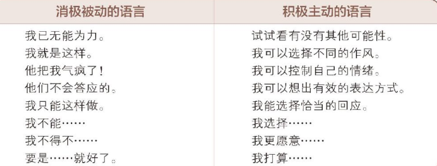
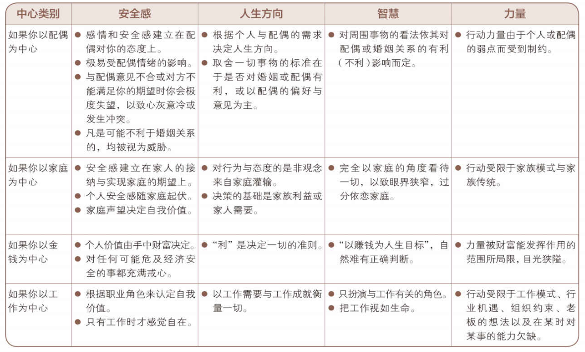
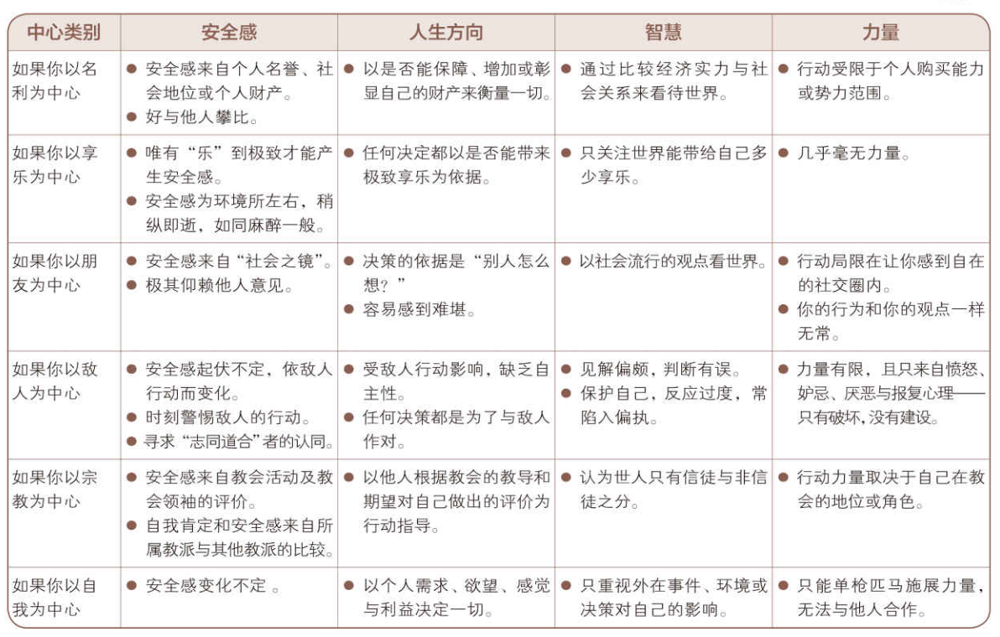
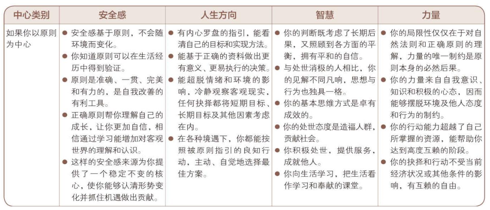
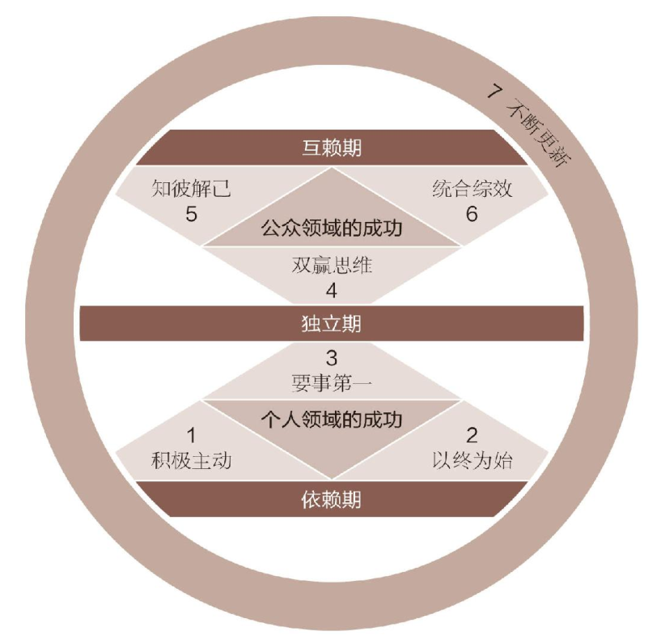

# 《高效能人士的七个习惯（30周年纪念版）》

更新：2026-08-26 16:35:48

# 摘录：

- 美国作家弗格森（Marilyn Ferguson）的一段话：谁也无法说服他人改变，因为我们每个人都守着一扇只能从内开启的改变之门，不论动之以情或晓之以理，我们都不能替别人开门。于是我去找朋友谈话，他只肯承认自己脾气不好，却不愿为自己的行为负责，也不愿意接受自己“情商”不足的事实，强烈的自尊心阻碍了他迈出改变的第一步。与配偶、子女、朋友或同事相处一定要学会聆听，这需要情感力量的支撑。聆听需要耐心、坦诚和理解对方的愿望，属于品德的高级范畴。相比之下，以低投入的情感给出“高高在上”的建议要容易得多。球技和琴艺如何，很容易判断，可品德和情感就不一样了或许只有真正经历过拥有，才会真正懂得分享。许多人在家庭或婚姻中只知机械式地付出，或者拒绝付出和分享，可能正是由于他们从未体验过拥有，而且缺乏自我认同和自尊。所以教育孩子应该要有充分的耐心让他们体会拥有的感觉，同时用足够的智慧告诉他们付出的价值，另外还要以身作则。
- 如果你想拥有美满的婚姻，那么就做一个能产生助力而非阻力的人，不要一味强求对方。如果你希望青春期的子女更听话，更讨人喜欢，那么先做个言行一致、充满爱心且懂得体谅的父母。如果你希望在工作上享有更多自
- 先做个更负责尽职的员工。如果你希望获得信任，那么先做个值得信任的人。如果你希望才华不被埋没，那么先修养自己的基本品德。
- 人的行为总是一再重复。因此卓越不是一时的行为，而是习惯。——亚里士多德（Aristotle）｜古希腊哲学家、文艺理论家
- 生理上无法独立（瘫痪或残疾）的人需要别人帮助；情感上不能独立的人，其价值和安全感都来自他人的看法，一旦无法取悦别人便会极度沮丧；智力上无法独立的人需要他人帮忙思考和解决生活中的大小问题。相反地，生理上独立的人可以自食其力；智力上独立的人可以有自己的
- 思想，兼具想象、思考、创造、分析、组织与表达的能力；情感上独立的人信心十足，能自我管理，不因他人好恶而影响自我价值评价。
- 人生本来就是高度互赖的，想要单枪匹马实现最大效能无异于缘木求鱼。
- 互赖是一个更为成熟和高级的概念。生理上互赖的人，可以自力更生，但也明白合作会比单干更有成效；情感上互赖的人，能充分认识自己的价值，但也知道爱心、关怀以及付出的必要性；智力上互赖的人懂得取人之长，补己之短。一个能做到互赖的人，既能与人深入交流自己的想法，也能看到他人的智慧和潜力。有些公司一方面大谈顾客至上，另一方面却完全忽略为顾客提供服务的员工。产出与产能平衡的原则告诉我们：你希望员工怎样对待顾客，就要怎样对待员工。
- 你可以买到员工的时间，却买不到他的心，而心才是忠诚与热忱的根源；你可以买到员工的体能，却买不到他的头脑，而头脑才是创造力与智慧的源泉。
- 产能要求像对待顾客一样对待员工，他们值得被视为珍宝，因为员工会贡献自己的精华——心和头脑。
- 积极主动与消极被动有天壤之别，尤其再加上聪明才智，差别就更大了。积极主动与消极被动之间的差别可不仅仅是提高20%~50%的效率，如果积极主动的人在智力、意识和敏感度方面技高一筹，那么差别就更大。
- 采取主动是实现人生产能与产出平衡的必要条件，对于培养七个习惯来说也不例外。本书的其余六个习惯，都以积极主动为根基，而每个习惯又都会激励你采取主动，但是如果你甘于被动，就会受制于人，面临截然不同的发展与机遇。

<!-- 这是一张图片，ocr 内容为： -->

- 看一个人的时间和精力集中于哪些事物，也能大致判断他是否积极主动。每个人都有格外关注的问题，比如健康、子女、事业、工作、国债或核战争等等，这些都可以被归入“关注圈”消极被动的人则全神贯注于“关注圈”，紧盯他人弱点、环境问题以及超出个人能力范围的事不放，结果越来越怨天尤人，一味把自己当作受害者，并不断为自己的消极行为寻找借口。错误的焦点产生了消极能量，再加上对力所能及之事的忽略，就造成了影响圈日益缩小。“如果”和“我可以”一个人的关注圈与影响圈可以从他的言谈中看出端倪，与关注圈相关的语句多半带有假设性质：  
  “要是我的房屋贷款付清了，我就没这么烦心了。”  
  如果我的老板不这么独断专行……”  
  “如果孩子肯听话……”  
  “如果我学历更高……”  
  “如果我有更多属于自己的时间……”

- 而与影响圈相关的语句则多半体现了这个人的品德修养，例如“我可以更耐心、更明智、更体贴……”

- 把外在环境视作问题症结的想法本身就成问题，应该说是我们给了外部环境控制自己的权力，这种“由外而内”求变的思维方式就是以外在环境改变作为个人改变的先决条件。积极的做法应该是“由内而外”地改变，即先改变个人行为，让自己变得更充实，更具创造力，然后再去施加影响，改变环境。
- 人的一生中，错误的选择在所难免，其后果让人悔不当初，却又无能为力，于是想象着如果再有一次机会，必会另作他选，这是值得我们深思的第二件事。
- 对于已经无法挽回的错误，积极主动的人不是悔恨不已，而是承认往日错误已属关注圈的事实，那是人力无法企及的范畴，既不能从头来过，也不能改变必然后果。
- 做出承诺与信守诺言正是培养高效能习惯的根本力量。知识、技巧和意愿都位于影响圈内，改善其中任何一项都会改善三者之间的平衡，三者的交集越大，就说明我们对于习惯及其原则的修养越完善，就越能够以崇高的品德实现平衡而高效能的生活。
- 积极的人使用积极的语言：“我能”、“我要”、“我宁愿”等等。消极的人使用消极的语言：“但愿”、“我办不到”、“我不得不”、“要是”。
- 当我面对伟大人物的墓地，妒忌之心荡然无存；当我阅读历代佳丽的碑文，贪婪的欲望顿然消失；当我在墓碑旁遇见泣不成声的父母，禁不住悲从中来；当我看到父母的坟墓，忍不住感到为那些自己即将追随的人而体味的痛苦是如此地空虚；当我看到王者与其废黜者的墓碑并肩而立，生前为不同观点唇枪舌战的文人墨客的遗体相邻而居，不禁感到那些内讧、派系斗争、人间是非的渺小。再查看墓碑上的日期，发现有些就在昨日，有些却可追溯到600年前，于是不禁想到当最后审判日那天来临，我们都将同样接受上帝的审判。
- 教育子女也要先定目标，才可能培养出既自律又有责任感的子女，在日常相处中牢记这个目标，不要做出任何有损他们自律或自尊的举动。
- 休太长的假，看太多的电影或电视，打太多的电子游戏，长期无所事事，都等于浪费生命，无益于增长智慧，激发潜能，增进安全感或指引人生，只不过制造更多的空虚而已。
- 以原则为中心  
  以正确原则为生活中心可以为发展上述四个支撑人生的因素奠定坚实的基础。认识到这一点，我们就有了安全感。原则是恒久不变、历久弥新的，不像其他中心那样多变，所以值得信赖，可以给我们高度的安全感。原则是理性而非感性的，因此能让我们充满信心，配偶和密友都可能离我们而去，但原则不会。原则不会怂恿你投机取巧，不劳而获，其有效性不取决于环境、他人行为或流行风尚。原则是永生的，不会毁于火灾、地震或偷盗，也不会今天在这儿，明天又到了那儿。

<!-- 这是一张图片，ocr 内容为： -->

<!-- 这是一张图片，ocr 内容为： -->

- 如果以原则为生活中心，智慧和人生方向的来源就是正确的地图，反映事物的真实历史和现状。正确的地图让我们能够清晰了解自己的目标以及实现途径，能够基于正确的资料做出更有意义、更易执行的决策。

<!-- 这是一张图片，ocr 内容为： -->

- 心灵演练与确认 施行自我领导不是只要撰写一个使命宣言就成了，它是一个确立愿景和价值观，并让自己的生活遵从这些重要原则的过程。右脑会在这个过程中帮助你进行心灵演练（Visualization），并对正确行为加以确认（Affirmation）。这会让你的生活更符合使命宣言，也是“以终为始”的另一种应用。
- 确认应该包括五个基本要素：个人、积极、果断、可视、情感。例如，“发现子女行为不当时，我（个人）能以智慧、爱心、坚定的立场与自制力（积极）及时应对（果断），结果让我深感欣慰（情感）。”
- 我每天都可以抽出几分钟，在身心完全放松的情况下，想象孩子们可能做出的各种不当行为，以及自己的反应。我尽量设想每一个细节，想象的细节越生动，脑海中的影像越清晰，就越能深刻体会到那种感觉，仿佛身临其境。有一次，我看到了女儿的不当行为，要在平常，这一定会让我心跳加剧，脾气失控，但是，这一次我在脑海中看到自己在关爱和自律的作用下做出了正确反应，于是加以“确认”。我能够按照自己的价值观和使命宣言来撰写程序，改写人生剧本。

  如能每天如此，我的行为就会在潜移默化中逐渐转变，直到能完全控制情绪，冷静应变。从此我的人生剧本将以我的价值观为依据，而不是外界环境。

  在商务谈判、上台表演、日常挑战或困难冲突到来之前，不妨参照以上范例多加演练，直到能够胸有成竹，感同身受，无所畏惧。

  在生活的各种情景下都能进行心灵演练，包括表演、销售展示、解决矛盾、实现会议目标，坚持不懈地不断练习，你会完成得清晰明确。内心会产生“熟悉感”，面对这样的场景时就不会觉得陌生、害怕。

- 家庭宣言是思考和管理家庭的框架。一旦出现问题和危机，它就会提醒全家人什么最重要，并基于正确的原则提供解决问题的办法和决策。
- 当我和家人制定家庭目标和活动时，我们考虑：基于原则我们该做什么；完成目标实现价值需要什么行动计划。
- 按照彼得·德鲁克（Peter Drucker）的观点，高效能人士的脑子里装的不是问题，而是机会。他们不会在各种各样的问题上浪费时间和精力，他们的思维方式是预防型的，总是能够做到防患于未然。妻子曾经受邀担任一个社区主席。其实有很多别的重要事务等她完成，但是迫于压力她最终还是接受了邀请。之后她打电话给一位闺蜜，询问对方是否愿意参加委员会。对方认真听了很久后说，“桑德拉，这个计划听起来很不错，确实值得一试。我非常感激你让我参与，但是我现在确实不能参加，我想让你知道我真的非常感谢你邀请我。”桑德拉本已做好了一切准备，但只欠一个礼貌的拒绝。她告诉我她真希望自己当时也能拒绝。

- 我的训练课程十分强调分辨轻重缓急以及按部就班行事。我常问受训人员：你的缺点在于——无法辨别事情重要与否？无力或不愿有条不紊地行事？缺乏坚持以上原则的自制力？答案多半是缺乏自制力，我却不以为然。我认为，那是“确立目标”的功夫还不到家使然。而且不能由衷接受“事有轻重缓急”的观念，自然就容易半途而废

- 责任型授权的关注重点是最终的结果。它给人们自由，允许自行选择做事的具体方法，并为最终的结果负责。起初，这种授权方式费时又费力，但却十分值得。通过责任型授权，可将杠杆的支点向右移动，提高杠杆的作用。

# 感想：

- 以身作则，多分享、做个言行一致、更负责的员工、做个值得信任的人。

- 习惯使你卓越。
- 生理上要独立、智力上要独立、情感上也要独立。
- 做事情积极主动。
- 远离消极被动的人。
- 抱怨太多不如抱怨自己老爸不是首富。
- 不犯错是不可能的，犯错之后应该怎样做才是最重要的，是怨天尤人还是反思总结。
- 做出承诺，信守承诺，你的信任度决定着你是否是一个值得信任的人。
- 不要想着去改变它人，如果你觉得它很消极，立马远离它！不说消极的语言，多说积极的语言。
- 世界上每个人的寿命都是一样的，如果使自己的一生过的有意义才是最重要的。
- 做任何事情都要设立目标，设立目标才会朝着这个目标前进。
- 如何平衡自己的生活、工作、学习是个值得反复思考的问题。
- 最好的就是以原则为中心。
- 做人做事都是以原则为中心。
- 心灵演练：每天都可以抽出几分钟在身心完全放松的时候想象食物的各种行为及自己的反应，如果能每天如此，行为就会在潜移默化中逐渐转变，直至能控制情绪，冷静应变。竞技运动和企业界的佼佼者都用这个方法，难怪它们遇到事情能更好的管理情绪。如果以后有家庭一定要弄家庭宣言，一旦出现问题，就会提醒全家人什么最重要。
- 如果别人邀请你或者给机会你，你不想去的时候先感激、再勇敢的说不。缺乏自制力是确立目标的方式不对。
- 责任型授权更好。
- 七个习惯：积极主动、以始为终、要事第一、双赢思维、知彼解己、综合综效、不断更新。总结就是：主动、有自己的原则、事件时间管理、利他即利己、聆听、互相交流、不断迭代自身体系。

<!-- 这是一张图片，ocr 内容为： -->

‍
