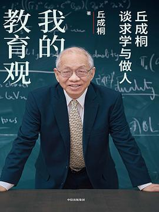

# 我的教育观

🕐 创建时间：2026-08-03 09:41 星期一

👁🗨 阅读状态：未读

---

|书名|我的教育观：|
| ----------| --------------|
|作者|(美) 丘成桐|
|分类|默认分类|
|出版社|中信出版社|
|出版日期|2025-2|
|豆瓣地址|[我的教育观](https://douban.com/isbn/9787521773286)|
|豆瓣评分|8.2 / 160 人|
|我的评分|未评分|

---

## 书籍简介

---

## 书评

# 📚【微信读书同步笔记】

## 前言 我对年轻人说的话

- 从哲学的角度思考、寻找大自然中的规律，以及从宏观的角度看问题，这套思考方法我很早便养成了。

  - 标注时间：2026-07-20 23:57:38

- 所以在数学研究中，我非常重视大数学家的看法。

  - 标注时间：2026-07-20 23:57:50

- 我在求真书院花了很多气力讲数学史，就是这个缘故。我希望学生学习数学史，让他们晓得伟大数学家的想法是怎么来的，从而思考他们以后的路要怎么走，我在培养这种文化。

  - 标注时间：2026-07-20 23:58:09

- 但其实数学史最终会变得重要，只是短期内看不到而已。要知道大学者的成功，都和他们善于学习前人有关。

  - 标注时间：2026-07-20 23:58:18

- 哲学始终是一门指导科学的学科，从古希腊开始，数学就是哲学的一部分。

  - 标注时间：2026-07-20 23:58:31

- 哲学是一门很宏观的学问，它不单研究一个个小问题，也研究哲学跟其他学科的关系，从这些关系中走出一条新的思路和方法。

  - 标注时间：2026-07-20 23:58:44

- 天赋只占很少一点，失败的经验比成功的经验更重要

  - 标注时间：2026-07-20 23:59:53

- 天赋不可能突然爆发，在脑海里产生很完整的构想，从历史上看也没有先例。

  - 标注时间：2026-07-21 00:00:16

- 所以人生的胜负就是看你自己的决心，你自己到底想要什么。

  - 标注时间：2026-07-21 00:01:44

- 决心要不要成大业，操于自己手上，有兴趣，有上进心，你就不怕。信心很重要，此外，个人与环境，尤其是人与人的关系也起着很重要的作用。

  - 标注时间：2026-07-21 00:02:05

- 这不是随便讲讲的，要不停地练、练、练，练到技巧可以随心所用的程度。

  - 标注时间：2026-07-21 07:59:03

- 失败后能不能站起来，这是一个很重要的事情，绝大部分人做不到。

  - 标注时间：2026-07-21 07:59:11

- 失败的经验比成功的经验更重要。

  - 标注时间：2026-07-21 07:59:18

- 我觉得对于家长来说。最好能够从小培养子女阅读的习惯，看书跟看互联网是不一样的，互联网上的信息很短暂。

  - 标注时间：2026-07-21 07:59:36

- 看书的方法很多，看书跟看互联网上的信息完全不一样，至少对我来说是不一样的。我会慢慢地咀嚼，慢慢地考虑。对我来讲，阅读是一个很重要的学习方法

  - 标注时间：2026-07-21 07:59:50

- 譬如孩子数学很好，他就喜欢看数学的参考书，但你也不妨鼓励他看看小说、计算机、名人传记等类别的图书。我从伟大学者的传记中受益匪浅

  - 标注时间：2026-07-21 08:00:06

- 书不要因为看不懂，便觉得没用。这就好像学语言，英文不好学，但如果跑到伦敦街头坐上两个月，我保证你的英文就会好很多，因为你不停地听，慢慢就学懂了。我一辈子学不同的学问，都是采取这种方法。

  - 标注时间：2026-07-21 08:00:46

- 看书也是这样，不是看一次就觉得看懂了，就有收获。其实一本书，看三次甚至十次都是正常的

  - 标注时间：2026-07-21 08:00:55

- 一个人假如对他做的事情兴趣不大，那么即便他完成了，也不会高兴。

  - 标注时间：2026-07-21 12:42:18

- 兴趣是非常重要的，假如你觉得一辈子就是为了赚钱，刚才我讲了，我并不反对，但要想清楚赚钱之余是否真的能快乐，值不值得，这是个根本的问题。

  - 标注时间：2026-07-21 12:42:33

- 兴趣在人生目标中扮演着重要的角色，学子立志，先要问自己的兴趣在哪里。

  - 标注时间：2026-07-21 12:42:43

- 为了攻克一个难题，我花了五六年工夫，其间饱受挫折，但我始终保持乐观，并享受其中的乐趣，最后在坚持中看到曙光，以至功成。

  - 标注时间：2026-07-21 12:53:44

- 向前走的时候，你看到一座小山，觉得风景不错，但是你看不到小山后面还有大山。翻过这座大山，后面还有更大的山。登上这座大山，眼前便是海阔天空，一望无际

  - 标注时间：2026-07-21 12:53:55

## 01 我的数学人生

### 我的数学之路

- 善待问者如撞钟，叩之以小者则小鸣，叩之以大者则大鸣

  - 标注时间：2026-07-21 13:01:23

- 这些教导的重要性在于：培养独立思考的习惯；在人前表达数学的时候，找出自己的弱点，与同学和老师一同切磋。这不论对我当下做学问还是对我日后的教学都十分重要。

  - 标注时间：2026-07-21 13:02:33
